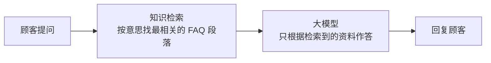

# 小满奶茶 · AI 知识库客服（Dify RAG）

一个用 [Dify](https://dify.ai) 搭的奶茶店智能客服：顾客问营业时间、外卖、会员、过敏等问题，它只根据店铺 FAQ 回答，查不到就转人工，不乱编。

👉 在线体验：<https://udify.app/chat/U7K8swFhasy3viRc>

> 店铺「小满奶茶」和 FAQ 内容均为虚构的示例数据，仅用于演示。

## 解决什么问题

小店客服每天重复回答同样的问题（几点关门、能不能外卖、会员怎么办）。把 FAQ 做成知识库，交给 AI 先答，常见问题秒回，人工只处理答不了的。

## 工作流程



这就是 RAG（检索增强生成）：先检索，再生成。

| 节点 | 作用 |
| --- | --- |
| User Input | 接收顾客的问题（`sys.query`） |
| Knowledge Retrieval | 在 FAQ 知识库里做语义检索，返回最相关的段落 |
| LLM | 系统提示词里放入检索结果 `{{#context#}}`，限定只按资料回答 |
| Answer | 输出回复 |

系统提示词：

```
你是小满奶茶的客服，只根据下面的资料回答，查不到就说"这个我帮您问一下店长"，语气亲切简短。
资料：{{#context#}}
```

## 效果

| 问题 | 表现 |
| --- | --- |
| 你们几点关门？ | 字面不同也能找到「营业时间」段落并正确回答 |
| 能外卖吗？ | 按 FAQ 外卖规则回答 |
| 我对牛奶过敏能喝什么？ | 按过敏说明给出建议 |
| FAQ 里没有的问题 | 回答「这个我帮您问一下店长」，不编造 |

截图见 `screenshots/`。

## 目录

```
knowledge/示例FAQ-奶茶店.md   知识库原始文档
screenshots/                  工作流和对话截图
```

## 怎么复现

1. 在 Dify 新建知识库，上传 `knowledge/示例FAQ-奶茶店.md`（默认分段即可）。
2. 新建 Chatflow：User Input → Knowledge Retrieval（选该知识库）→ LLM（Context 选检索结果，填上面的提示词）→ Answer。
3. 在 Preview 里测试，然后 Publish。

## 技术栈

Dify Cloud · 知识库 / 向量检索 · RAG · Prompt Engineering
